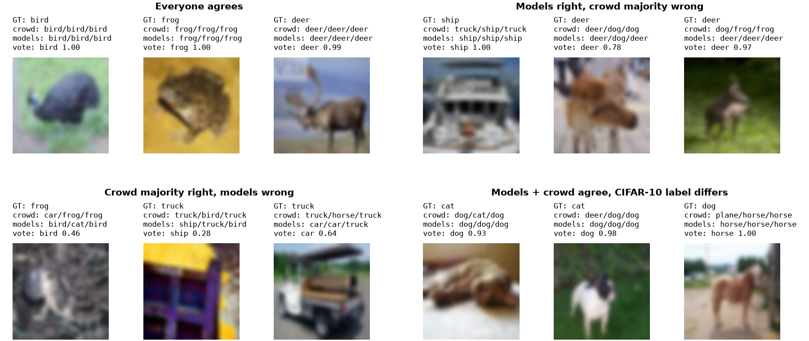
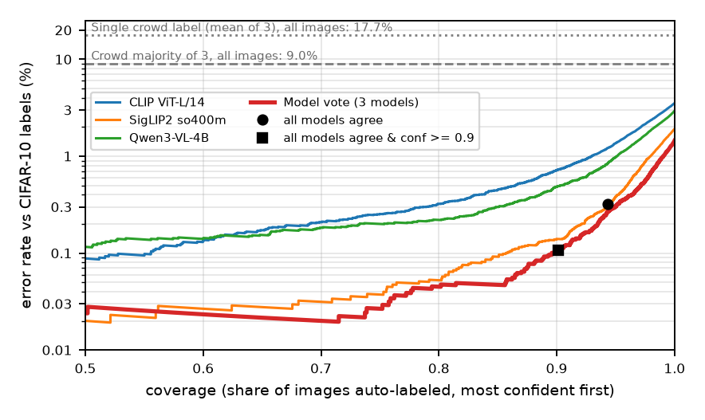

# Auto-labeling CIFAR-10 with foundation models vs. crowd-worker labels

**Summary.** Three open foundation models, run locally on one consumer GPU, label all 50,000 CIFAR-10
training images zero-shot in **40 GPU-minutes**. Their calibrated vote matches the CIFAR-10 labels on
**98.6%** of images, versus 82.3% for a single crowd worker and 91.0% for the majority of three workers
(CIFAR-10N, 194.5 worker-hours). If the 9.9% of images where the models disagree or are unsure go to a
reviewer, the other 90.1% are auto-labeled at **99.89%** accuracy.

## 1. Setup

- **Dataset.** CIFAR-10 has 32×32 photos in 10 classes. I label the 50k **training** images because
  they have human labels from **CIFAR-10N** (Wei et al., ICLR 2022): three independent Amazon MTurk
  labels per image, plus annotation times. The 10k **test** images serve only as a **dev split** for
  choosing prompts, fitting calibration and setting the review rule, so every train-set number below
  is out-of-sample.
- **Input feature:** the raw RGB image only. **Labeling target:** one of the 10 classes (airplane,
  automobile, bird, cat, deer, dog, frog, horse, ship, truck). The reference is the CIFAR-10 label.
- **Models.** All three are open-weight and run with **local inference** (Hugging Face `transformers`,
  fp16/bf16, one RTX 4060 Ti 16 GB), so there are no API fees, outputs are deterministic, and no data
  leaves the machine. **CLIP** ViT-L/14 and **SigLIP2** so400m are contrastive image-text models used
  as zero-shot classifiers. **Qwen3-VL-4B-Instruct** is a generative vision-language model (VLM) that
  is asked to name the class.

## 2. Pipeline and prompt design (`demo_code.py`)

1. **Read the data.** torchvision provides CIFAR-10. The CIFAR-10N labels (a pickled `.pt` file) are
   loaded with a type allow-list and checked to be in the same image order.
2. **Call the models** in batches; raw scores are cached in `outputs/probs/`.
    - *Contrastive models:* each class is the mean text embedding of its prompts, and an image's
      score for a class is the scaled cosine similarity. I compared three prompt sets: `simple`
      ("a photo of a {c}."), `templates` (CLIP's 18 CIFAR-10 templates), and `guided`. `guided` adds
      three low-resolution templates ("a pixelated photo of a {c}.") and fills all of them with
      synonyms that encode CIFAR-10's class definitions: automobile is car, sedan or SUV; truck is
      lorry, fire truck, semi or dump truck; frog includes toad; bird includes ostrich.
    - *VLM:* the chat message is the image plus *"What is the main object in this image? Answer with
      one word from this list: airplane, automobile, …, truck."* Instead of generating text and
      parsing it, one forward pass reads the probability of each label word's first token at the
      answer position (**constrained decoding**). The answer is always a valid class and comes with
      a full distribution. Images are upscaled to 224 px; on 1k dev images, 128 px loses 1.5 points
      and 256 px gains nothing.
3. **Output.** Each model's scores go through a softmax with a temperature fit on the dev split, and
   the **vote** is the mean of the three calibrated distributions. `outputs/labels_train.csv` has one
   row per image. It holds the ground truth, the 3 crowd labels and their majority, each model's label
   and confidence, and the vote's label and confidence. It also has `n_agree`, the number of models
   that agree with the vote, and `needs_review`, which is true if the models disagree or the vote
   confidence is below 0.9. `analyze.py` computes every number below (`outputs/metrics.json`) and the
   figures.

## 3. Results

**Prompts (dev split).** Guided prompts were best for the contrastive models. CLIP scored 95.2%
(simple), 95.6% (templates) and **96.4%** (guided); SigLIP2 scored 97.5%, 97.8% and **98.0%**. The
largest gains are on the classes the definitions target: CLIP's truck accuracy rose from 94.7% to
98.6%, and its frog accuracy from 85.8% to 90.9%. The VLM did not benefit from a longer guided prompt
(96.84% vs. **96.91%**). The final setup is therefore guided prompts for CLIP and SigLIP2 and the
simple prompt for Qwen3-VL. With this setup, the vote scores 98.5% on the dev split and 98.6% on the
train split.

| Labeler (train split, 50k images) | Accuracy vs. CIFAR-10 | Agreement with crowd majority (κ) | Time for 50k images |
|---|---|---|---|
| One crowd label (mean of the 3) | 82.3% | n/a | 64.8 worker-hours (4.7 s/image) |
| Crowd majority of 3 | 91.0% | n/a | 194.5 worker-hours |
| CLIP ViT-L/14 | 96.5% | 89.2% (0.88) | 5.4 min (155 images/s) |
| SigLIP2 so400m | 98.1% | 90.3% (0.89) | 6.3 min (132 images/s) |
| Qwen3-VL-4B | 97.1% | 89.8% (0.89) | 28.6 min (29 images/s) |
| **Vote of the 3 models** | **98.6%** | 90.7% (0.90) | 40.3 min |
| Vote, auto-labeled 90.1% only | **99.89%** | n/a | n/a |

No model agrees with the crowd majority on more than about 91% of images, because the crowd majority
itself is wrong on 9%. The models agree with each other far more than the workers do: all three
models agree on 94.3% of images (Fleiss' κ 0.96), all three workers on 60.4% (κ 0.68).

## 4. Patterns: where the models work and where they fail

- **Easy cases.** Large, centered objects are labeled almost perfectly: the vote is at least 99.0%
  accurate on automobile, bird, horse, ship and truck. When all three models agree (94.3% of images)
  the vote is 99.7% accurate; when two of three agree (5.0%), 82%; when all three differ (0.7%), 63%.
- **Failures are look-alikes and unusual views at 32 px.** The vote's most frequent errors are cat→dog
  (106 images), dog→cat (82), frog→bird (58) and deer→horse (54); the weakest classes are cat (96.7%)
  and frog (97.4%). In Figure 1 (bottom left), a frog is called bird, an unusual close-up of a truck
  is called ship, and a small utility truck is called car. However, the models usually know when
  they are wrong: those three votes have confidence 0.28–0.64. Overall, the review rule catches 93%
  of the vote's errors while sending only 9.9% of images to review.
- **Hard for humans is hard for models.** On the 1,067 images where none of the three workers was
  right, the vote is right on 83.8%; where all three were right, on 99.5%. Some hard images are
  mislabeled in CIFAR-10 itself: on 29 images, the three models agree with each other and with the
  crowd majority, at a vote confidence of at least 0.9, against the CIFAR-10 label. By visual
  inspection, about 23 of these are real CIFAR-10 errors, mostly cat/dog swaps and birds labeled
  airplane (Figure 1, bottom right; `outputs/suspected_label_errors.csv`). Accuracies above about
  99.5% are therefore within the noise of the reference labels.

<b>Figure 1.</b> Random samples from four groups (all listed in
<code>outputs/examples.csv</code>). Each caption gives the CIFAR-10 label (GT), the 3 crowd labels,
the labels from CLIP, SigLIP2 and Qwen3-VL in that order, and the vote with its calibrated
confidence.

- **The VLM needs care.** Before calibration it is over-confident: its mean confidence is 0.993 at
  96.9% accuracy, and 39% of its errors have confidence above 0.99. Temperature scaling (T = 2.9)
  cuts its calibration error (ECE) from 2.4% to 0.4%, and on the train split all three models have
  an ECE of 0.3% or less. Rewording its prompt flips 1.7% of its labels. Constrained decoding also
  hides abstentions. On the 0.02% of images where less than 90% of its next-token probability falls
  on the class names, free generation often answers *"None of the above"*, which constrained decoding
  turns into *bird*. Bird is its default when unsure: it labels 10.9% of all images as bird.

## 5. Humans vs. foundation models

| | Crowd workers (CIFAR-10N) | Foundation models (this pipeline) |
|---|---|---|
| Speed | 4.7 s per image per worker (median 4.2 s) | 29 to 155 images/s per model on one GPU |
| Cost (50k images) | 194.5 worker-hours for 3 labels per image, about US$1.4k even at US$7.25/h | 40 GPU-minutes (under 0.2 kWh) and no API fees, plus a one-off 14 GB weight download and prompt engineering |
| Consistency | All 3 workers agree on 60.4% of images; about 1% slips into unrelated classes (e.g. frog→automobile 1.5%) | Deterministic, and the 3 models agree on 94.3%. Rewording a prompt flips 1.7% of the VLM's labels |
| Semantic understanding | Uses context, but applies its own notion of the classes: 12.4% of trucks are labeled automobile and 9.9% of automobiles truck | Strong object recognition. Follows the class definitions only when told (the vote labels 0.9% of automobiles truck); misreads small objects and unusual views |
| Bias | Over-uses *automobile* (11.0% of labels for a 10% class) and under-uses *deer* (8.9%) | Qwen3-VL over-uses *bird* (10.9%) and CLIP under-uses *frog* (9.0%). Pretraining may include CIFAR-like web images, which would make zero-shot accuracy optimistic |

## 6. Improvements, all measured on this data

<b>Figure 2.</b> Error rate on the auto-labeled images when the most confident
images are accepted first (train split).

1. **Better prompts.** Adding the class definitions as synonyms, plus low-resolution templates, gives
   +1.2 points for CLIP and +0.5 for SigLIP2. For the VLM, the prompt should be chosen on a dev split
   rather than by intuition, since the longer prompt did not help.
2. **Multi-model voting.** The vote (98.6%) beats the best single model (SigLIP2, 98.1%), because
   contrastive and generative models make partly different errors. A soft vote over probabilities is
   slightly better than a hard majority vote (98.4%).
3. **Calibration and confidence filtering.** After temperature scaling, the confidence threshold
   trades quality against review cost (Figure 2). Requiring unanimity and confidence ≥ 0.9
   auto-labels 90.1% of images at 99.89% accuracy; a threshold of 0.99 auto-labels 70.8% at 99.98%.
4. **Human-in-the-loop, with the right humans.** On the 9.9% of images the review rule flags, the
   vote is right 86% of the time, a single crowd label 64%, and the crowd majority 71%. Sending them
   to crowd workers would *lower* overall accuracy from 98.6% to 96.4–97.0%; sending them to an
   expert (simulated with the CIFAR-10 label) raises it to 99.9%, at 0.1 expert labels per image.
   The vote also audits crowd labels: when a confident vote (≥ 0.9) contradicts the crowd majority,
   the crowd is wrong 99.6% of the time, and this finds 67% of the crowd majority's errors.

**Limitations and next steps.** CIFAR-10 has 10 coarse, everyday classes; fine-grained,
domain-specific or subjective labeling would be harder and needs a small expert-labeled set to measure
against. The crowd baseline is MTurk workers combined only by majority vote, and a trained team with
guidelines would likely do better. Next, I would train a linear probe on a few hundred expert labels, use the
VLM's "None of the above" as an out-of-taxonomy flag, and re-calibrate the vote, whose mean confidence
(96.2%) is below its accuracy (98.6%), so the 0.9 threshold is conservative.
